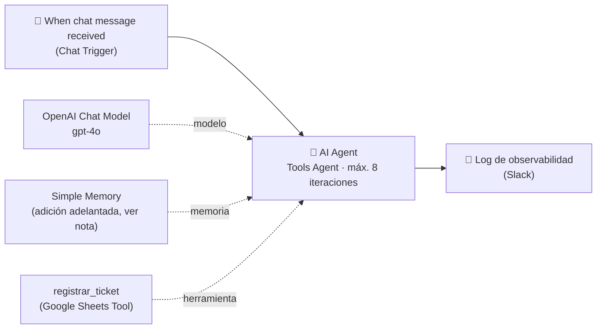

# Entregable 1 — Agente base y motor de razonamiento

**Checkpoint de Configuración e Interfaces Agénticas (M1)**
Archivo: [`checkpoint1_bruno_acorsi.json`](checkpoint1_bruno_acorsi.json)

## Qué hace

**ProTable Support Triage Agent** recibe por chat la consulta de un restaurante que
usa ProTable, la analiza (qué, cómo, cuándo, dónde), la clasifica por categoría y
prioridad, y decide de forma autónoma si la resuelve con el FAQ oficial o si la
registra como ticket para el equipo humano. Cada interacción termina en un reporte a
Slack con la consulta, la respuesta y las herramientas que usó el agente.

## Cómo cumple la consigna

| Requisito | Cómo está resuelto |
|---|---|
| **Disparador** | `Chat Trigger` (*When chat message received*) captura el mensaje desestructurado del usuario. |
| **AI Agent en modo Tools Agent** | Nodo AI Agent v3.1. En esta versión el Tools Agent es el único modo del nodo, por eso ya no aparece un selector de modo. |
| **Modelo de lenguaje nativo** | `OpenAI Chat Model` con **gpt-4o**, conectado al puerto *Chat Model* del agente. |
| **Guardrail de iteraciones** | *Options → Max Iterations* = **8** (rango pedido: 5 a 10). |
| **System Prompt modular** | Rol y objetivo → Empresa (ámbito) → Usuario y estilo → Fuentes permitidas → **Guardrails** (lista explícita de lo que nunca hace) → Proceso de triage → Clasificación, prioridad y **escalamiento** → Uso de la herramienta → Formato de respuesta → Ejemplos → Checklist. Redactado sin lenguaje inclusivo. |
| **Herramienta lateral** | `registrar_ticket` (Google Sheets, *Append row*) conectada al puerto *Tool* del agente, no como nodo secuencial. |
| **Descripción semántica extensa** | Descripción manual de ~1.600 caracteres: cuándo usarla, cuándo no (FAQ, datos incompletos, spam, duplicados) y cómo informar el resultado. Cada columna usa `$fromAI` con su propia descripción. |
| **Sin bloques de decisión rígidos antes del agente** | El flujo es Trigger → Agente directo. La decisión de usar la herramienta la toma el modelo. |
| **Observabilidad** | Nodo final de Slack que publica la consulta, la respuesta y el **execution log**: cada herramienta invocada con su input y su resultado (`returnIntermediateSteps` activado). |

## Nota: el nodo Simple Memory es una adición hacia adelante

El workflow incluye un nodo **Simple Memory** conectado al puerto *Memory* del agente.
**No es un error de importación ni un requisito de este checkpoint:** la memoria es
tema formal del **Módulo 3** del proyecto integrador. Lo sumé por adelantado porque el
agente es conversacional y, sin memoria, pierde el hilo entre un mensaje y el
siguiente (por ejemplo, si el usuario da su nombre y el local en un mensaje y el
problema en otro).

- **Qué hace acá:** guarda los últimos intercambios de la conversación en la memoria
  interna de n8n, indexados por la sesión del chat (memoria de corto plazo).
- **Qué no hace:** no persiste nada fuera de n8n, no escribe en ninguna base y se
  pierde si la instancia se reinicia.
- **Cómo evoluciona:** en el [Entregable 3](../entregable-3/) se formaliza como memoria
  híbrida: corto plazo en n8n y largo plazo por `Session_ID` en Google Sheets, con
  resumen automático.
- **Si se quiere evaluar el M1 "puro":** se puede desconectar este nodo sin afectar el
  resto del flujo; el agente sigue funcionando, solo que sin recordar mensajes previos.

## Pruebas de validación (reproducibles)

Cada corrida se ejecutó manualmente desde el chat del workflow. Para repetir la
auditoría, pegá el **mensaje exacto** de la columna "Prompt de prueba" en el chat y
compará con el resultado esperado.

| # | Ejecución | Prompt de prueba (exacto) | Qué valida | Resultado esperado | Resultado obtenido |
|---|---|---|---|---|---|
| 1 | 23 · 2026-09-26 | `Hola, soy Bruno Acorsi, encargado del local "Cafe Prueba Checkpoint 1" (esto es una PRUEBA del checkpoint). Desde las 20:00 de hoy los pedidos que hacen los clientes desde el menu QR no aparecen en el KDS de cocina, en ninguna mesa. Antes funcionaba bien. Ya reiniciamos la tablet del KDS y sigue igual. Estamos tomando pedidos a mano. Necesito que quede registrado para que lo vea el equipo tecnico.` | Falla operativa con los datos completos: el agente tiene que decidir solo usar la herramienta | `BUG`, prioridad P2, acción `ESCALATE`, llamada a `registrar_ticket`, log en Slack | ⚠️ **Parcial.** El agente clasificó bien (`BUG`, `P2 - HIGH`, `ESCALATE`) y registró el ticket, pero el nodo de Slack falló por un error de sintaxis en la expresión del log. **Corregido** antes de la corrida 2 |
| 2 | 24 · 2026-09-26 | `Hola, soy Bruno Acorsi, encargado del local "Cafe Prueba Checkpoint 1" (PRUEBA 2 del checkpoint). Desde hace una hora el cobro con MercadoPago desde el menu QR queda en "procesando" y no se acredita ningun pago, en todas las mesas. Ayer funcionaba bien. Necesito que quede registrado para que lo revise el equipo.` | Mismo caso, con el log corregido: recorrido completo en verde | `BILLING`, P2, llamada a `registrar_ticket`, log en Slack con el execution log | ✅ **Todo en verde (8,5 s).** `BILLING` · `P2 - HIGH`; `registrar_ticket` con Nombre "Bruno Acorsi", Empresa "Cafe Prueba Checkpoint 1", Categoría `BILLING`; Slack respondió `ok: true` |
| 3 | 124 · 2026-09-29 | `Hola, soy Bruno, del local Café Centro. ¿Cómo hago para cambiar el logo que aparece en el menú QR de mi local?` | Caso contrario: una consulta de uso **no** tiene que generar un ticket | `HOW_TO`, P4, acción `RESOLVE`, **sin** llamar a la herramienta | ✅ **Todo en verde (4,7 s).** `HOW_TO` · `P4` · `RESOLVE`; herramientas usadas: **ninguna**; respondió con los pasos y el log llegó a Slack |

Las corridas 2 y 3 muestran la bifurcación probabilística que pide la consigna: con el
mismo agente y la misma herramienta, el modelo decide usarla ante una falla operativa
y no usarla ante una consulta de uso.

## Cómo probarlo

1. Importá `checkpoint1_bruno_acorsi.json` en n8n.
2. Asigná tus credenciales en **OpenAI Chat Model**, **registrar_ticket** (Google
   Sheets OAuth2, con una planilla que tenga la hoja `Tickets` y las columnas
   `Nombre/contacto`, `Empresa`, `Categoría`, `Prioridad`, `Resumen`) y **Log de
   observabilidad** (Slack, eligiendo tu canal).
3. Abrí el chat del workflow y repetí los prompts de la tabla de pruebas de arriba.
   - La consulta de uso (prueba 3) se responde sin ticket.
   - La falla operativa con los datos completos (pruebas 1 y 2) dispara `registrar_ticket`.

## Próximo paso (M2)

Sumar un Manager que derive a workers especializados (facturación, soporte, ventas)
como sub-workflows, partiendo de este mismo `.json`.
