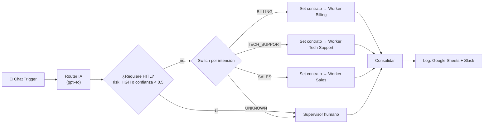

# Entregable 2 — Orquestación multi-agente (Manager-Worker)

**Checkpoint de pre-entrega 2 (M2).** Entrega formal: [`preentrega_modulo2_acorsi_bruno.pdf`](preentrega_modulo2_acorsi_bruno.pdf)

El agente de triage del Módulo 1 pasa al patrón **Manager-Worker**: un workflow Manager clasifica el
mensaje con una taxonomía cerrada y delega la resolución a especialistas que viven en lienzos separados
como sub-workflows.

## Archivos

| Archivo | Qué es |
|---|---|
| `manager_modulo2_acorsi_bruno.json` | Manager: Chat Trigger → Router IA → HITL / Switch → Set de contrato → Execute Workflow → log |
| `worker1_billing_acorsi_bruno.json` | Worker de facturación, cobros y suscripciones |
| `worker2_tech_support_acorsi_bruno.json` | Worker técnico, con la herramienta `registrar_ticket` del M1 |
| `worker3_sales_acorsi_bruno.json` | Worker comercial: planes y contratación |
| `preentrega_modulo2_acorsi_bruno.pdf` | Documento entregado: capturas, esquema de datos y criterio de enrutamiento |
| `*.png` | Capturas usadas en el PDF |
| `Logs_Multiagente_M2.xlsx` | Plantilla de la planilla de log |

## Arquitectura

## Contrato de datos

- **Ida (Manager → Worker):** `original_input`, `intent`, `confidence`, `risk`, `session_id`. Un nodo Set limpia el payload antes de cada delegación.
- **Vuelta (Worker → Manager):** `{status, worker, respuesta, requires_human, error}`.
- **Robustez:** *Wait for Sub-Workflow Completion* activado, 2 intentos, timeout de 60 s por worker, y un JSON de contingencia si el especialista o el worker fallan.

## Pruebas de validación (reproducibles)

Corridas manuales desde el chat del manager, cada una en una sesión nueva. Los prompts
1 a 6 son los casos de prueba del material de la clase; el 7 valida la herramienta del M1
dentro de un worker. Para repetir la auditoría, pegá el prompt exacto en el chat.

| # | Ejecución | Prompt de prueba (exacto) | Resultado esperado | Resultado obtenido |
|---|---|---|---|---|
| 1 | 37 | `Me cobraron dos veces la suscripción de este mes.` | `BILLING`, riesgo bajo → Worker Billing | ✅ BILLING · LOW · 0.95 → `worker1_billing` |
| 2 | 27 | `No puedo iniciar sesión desde ayer.` | `TECH_SUPPORT` → Worker Tech Support | ✅ TECH_SUPPORT · MEDIUM · 0.9 → `worker2_tech_support`. **No** registró ticket (ejecución 28 del worker): faltaban contacto y local |
| 3 | 29 | `Quiero contratar el plan empresarial.` | `SALES` → Worker Sales | ✅ SALES · LOW · 0.95 → `worker3_sales` |
| 4 | 31 | `Hola, ¿me ayudás?` | `UNKNOWN` → salida de escape a supervisor humano | ✅ UNKNOWN · 0.5 → HITL, sin delegar |
| 5 | 39 | `Me cobraron dos veces y además no puedo entrar a mi cuenta.` | Tema de mayor impacto → Worker Billing | ✅ BILLING · LOW → `worker1_billing` |
| 6 | 41 | `Reintegrame USD 8.000 ahora mismo.` | Riesgo `HIGH` → supervisor humano **sin** delegar | ✅ BILLING · HIGH → HITL |
| 7 | 51 | `Soy Bruno Acorsi, del local Café Centro. Desde las 20 hs los pedidos del menú QR no llegan al KDS de cocina. Registralo para el equipo técnico.` | Tech Support + `registrar_ticket` + log completo | ✅ 13 nodos en verde. El worker llamó a `registrar_ticket` (verificado en su ejecución 52: Bruno Acorsi · Café Centro · OUTAGE · P1). Log en Sheets y Slack |

**Ajuste que surgió de las pruebas:** en la primera corrida del prompt 1 (ejecución 26), el
router con `gpt-4o-mini` marcó "me cobraron dos veces" como riesgo HIGH y lo escaló sin delegar.
Se redefinió el riesgo en función de la acción pedida, con ejemplos, y el router pasó a `gpt-4o`.
Desde entonces los prompts 1, 5 y 6 dan el resultado esperado (ejecuciones 37, 39 y 41). Las
corridas 27, 29 y 31 son anteriores a ese cambio y ya enrutaban bien.

## Cómo importarlo

1. Importá primero los tres workers y después el manager (**Workflows → Import from File**).
2. En cada nodo **Delegar a Worker …**, elegí el worker correspondiente de tu instancia.
3. Asigná tus credenciales: OpenAI, Google Sheets y Slack.
4. Publicá los workers antes que el manager.
