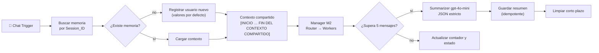

# Entregable 3 — Memoria persistente y resumen agéntico

**Checkpoint de pre-entrega 3 (M3).** Entrega formal: [`PreEntrega_Modulo3_BrunoAcorsi.pdf`](PreEntrega_Modulo3_BrunoAcorsi.pdf)

El manager multi-agente del M2 suma una **capa de memoria híbrida**. El largo plazo es una fila por
`Session_ID` en Google Sheets; el corto plazo son los últimos intercambios en la memoria de n8n. Cuando
la conversación supera los 5 mensajes, un modelo económico (`gpt-4o-mini`) la resume en un JSON estricto
y sobreescribe la fila de la sesión. Los workflows del M2 quedan intactos: el M3 son copias con sufijo `_modulo3_`.

## Archivos

| Archivo | Qué es |
|---|---|
| `manager_modulo3_acorsi_bruno.json` | Manager M2 + lectura y escritura de memoria + summarization |
| `worker1_billing_modulo3_acorsi_bruno.json` | Worker Billing con la memoria en su System Prompt |
| `worker2_tech_support_modulo3_acorsi_bruno.json` | Worker Tech Support (agente del M1 + `registrar_ticket`) con memoria |
| `worker3_sales_modulo3_acorsi_bruno.json` | Worker Sales con memoria |
| `PreEntrega_Modulo3_BrunoAcorsi.pdf` | Documento entregado: lienzo, prompt del summarizer, esquema de la base y anexo de QA |
| `1a-…izquierda.png`, `1b-…derecha.png` | Capturas del lienzo usadas en el PDF |

## Circuito de memoria

## Base de memoria (`Memoria_M3`)

| Columna | Tipo | Contenido |
|---|---|---|
| `Session_ID` | texto (clave) | Identificador de la conversación. Una fila por sesión |
| `Fecha_Actualizacion` | fecha ISO | Última actualización de la fila |
| `user_name` | texto | Nombre del usuario, detectado por el router |
| `Estado_Caso` | texto | `NUEVO` · `EN_CURSO` · `ESCALADO_HUMANO` · `ERROR` · `RESUELTO` |
| `Resumen_Consolidado` | texto (JSON) | `{asunto_principal, puntos_clave, accion_requerida}` |
| `Datos_Clave` | texto | Los puntos clave y la acción, en texto plano |
| `contador_mensajes` | número | Mensajes desde el último resumen |

La base guarda solo el resumen y los datos clave: nunca la conversación completa, ni payloads, ni logs técnicos.

## Pruebas de validación (reproducibles)

La memoria solo se puede validar con **varios mensajes en la misma sesión**. Para repetir la
auditoría, abrí el chat del manager, iniciá una sesión nueva y mandá estos mensajes **en orden,
sin cambiar de sesión**.

### Batería 1 · Memoria y resumen (ejecuciones 67 a 78)

| # | Prompt de prueba (exacto) | Qué valida | Resultado obtenido |
|---|---|---|---|
| 1 | `Hola, soy Bruno, encargado del local Café Centro.` | Usuario nuevo: se registra desde cero | ✅ Fila nueva en `Memoria_M3`, nombre "Bruno", contador 1 |
| 2 | `Desde las 20 hs los pedidos del menú QR no llegan al KDS de cocina.` | Usuario recurrente | ✅ Memoria encontrada; Tech Support registra el ticket; contador 2 |
| 3 | `Ya reiniciamos la tablet del KDS y sigue igual.` | Contexto reciente | ✅ El worker ve los intercambios anteriores; contador 3 |
| 4 | `Además me cobraron dos veces la suscripción de este mes.` | Cambio de tema en la misma sesión | ✅ BILLING; contador 4 |
| 5 | `¿Qué plan me conviene si abro un segundo local?` | Tercer especialista | ✅ SALES; contador 5 |
| 6 | `¿Me confirmás en qué quedó lo del KDS?` | **Supera 5 mensajes → resumen** | ✅ `gpt-4o-mini` devuelve `{asunto_principal, puntos_clave, accion_requerida}`; la fila se sobreescribe; contador 0; corto plazo limpio |
| 7 | `Hola de nuevo, ¿hay novedades de lo mío?` | Contexto después del resumen | ✅ Responde sobre el KDS usando solo el resumen; contador 1 |

### Batería 2 · Calidad de las respuestas después del QA (ejecuciones 106 a 117)

Los mismos mensajes, más `Reintegrame USD 8.000 ahora mismo.` para validar el escalamiento.
El mensaje 2 no se ejecutó en esta batería porque n8n limitó las llamadas; la cobertura de
Tech Support quedó en el mensaje 3.

| Prompt | Resultado obtenido |
|---|---|
| `Hola, soy Bruno, encargado del local Café Centro.` | ✅ Bienvenida con el nombre, sin derivar a un humano |
| `Ya reiniciamos la tablet del KDS y sigue igual.` | ✅ Llama a `registrar_ticket` (OUTAGE, P2) y responde "Quedó registrado un ticket…" |
| `Además me cobraron dos veces la suscripción de este mes.` | ✅ "Lamentamos el inconveniente. Pasame la fecha y el monto de los dos cobros…" |
| `¿Qué plan me conviene si abro un segundo local?` | ✅ Pregunta por el volumen de pedidos; no inventa planes ni precios |
| `¿Me confirmás en qué quedó lo del KDS?` | ✅ Confirma el ticket, respaldado por la llamada real a la herramienta |
| `Hola de nuevo, ¿hay novedades de lo mío?` | ✅ Dispara el resumen; no promete avisos ni plazos |
| `Reintegrame USD 8.000 ahora mismo.` | ✅ Riesgo HIGH → pasa a una persona; el mensaje no muestra el criterio interno |

El detalle completo del QA (37 ejecuciones, tabla de antes y después) está en el anexo del
[PDF](PreEntrega_Modulo3_BrunoAcorsi.pdf).

## Cómo importarlo

1. Creá una planilla de Google Sheets con las 7 columnas de arriba.
2. Importá los tres workers y después el manager.
3. En el manager, apuntá los 4 nodos de Google Sheets de memoria a tu planilla, y los 3 nodos **Delegar a Worker …** a tus workers.
4. Asigná tus credenciales (OpenAI, Google Sheets y Slack) y publicá primero los workers.
5. Probalo desde el chat con 6 o más mensajes en la misma conversación.
