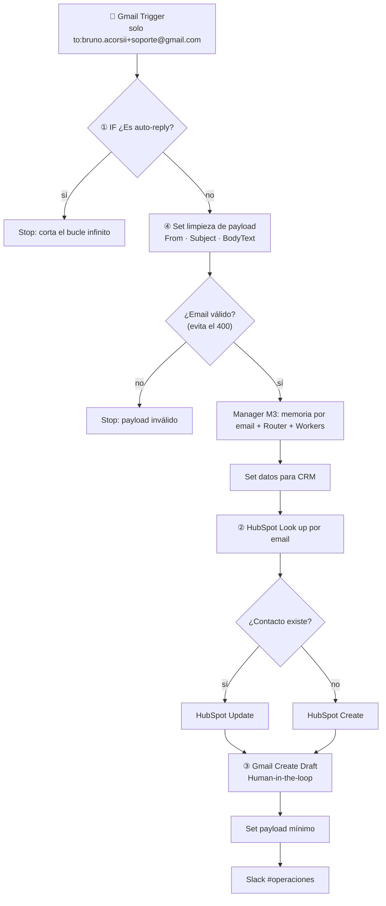

# Entregable 4 — Integraciones: CRM + Gmail + Slack

**Checkpoint de Integraciones Avanzadas (M4).** Archivo de entrega:
[`checkpoint4_bruno_acorsi.json`](checkpoint4_bruno_acorsi.json)

El sistema multi-agente con memoria del Módulo 3 deja de ser un chat y pasa a atender la **casilla de
soporte por email**. Se conecta a tres herramientas reales del negocio por OAuth2: **HubSpot** (CRM),
**Gmail** (casilla de soporte) y **Slack** (canal de operaciones).

## Archivos

| Archivo | Qué es |
|---|---|
| `checkpoint4_bruno_acorsi.json` | Workflow principal: entrada por Gmail, controles, manager M3 con memoria, CRM, borrador y Slack |
| `worker1_billing_modulo4_acorsi_bruno.json` | Worker de facturación (sub-workflow) |
| `worker2_tech_support_modulo4_acorsi_bruno.json` | Worker técnico con la herramienta `registrar_ticket` (sub-workflow) |
| `worker3_sales_modulo4_acorsi_bruno.json` | Worker comercial (sub-workflow) |

## Arquitectura

## Los 4 nodos que evalúa la rúbrica

| # | Nodo en el lienzo | Qué riesgo neutraliza |
|---|---|---|
| ① | **① IF - ¿Es auto-reply?**, inmediatamente después del trigger | **Bucle infinito.** Ignora asuntos con *Auto-reply*, *Automatic reply*, *Respuesta automática*, *Out of office*, *Fuera de la oficina*, *Undeliverable*, *Delivery Status Notification*; remitentes *no-reply*, *noreply*, *mailer-daemon*; y el encabezado `auto-submitted` |
| ② | **② HubSpot - Look up contacto** antes del Create | **Error 409 (duplicados).** Busca por email: si el contacto existe va a **Update**, si no a **Create** |
| ③ | **③ Gmail - Create Draft (HITL)** | **Envío sin control.** La IA nunca envía: deja un borrador en el mismo hilo para que una persona lo apruebe |
| ④ | **④ Set - Limpiar payload email** + **¿Email válido?** | **Error 400 y datos sucios.** Deja solo From, Subject y BodyText; quita HTML, adjuntos, links, firmas automáticas y el texto citado de respuestas anteriores; frena si el email no es válido |

Además, **Set - Payload mínimo Slack** manda al canal solo un texto de resumen, nunca el objeto
completo del email (paso 8 de la consigna).

## Mínimo privilegio

| Herramienta | Credencial | Qué lee | Qué escribe |
|---|---|---|---|
| Gmail | OAuth2 | Solo los correos **no leídos** dirigidos a `bruno.acorsii+soporte@gmail.com` (filtro del trigger) | Solo **borradores**: el flujo no tiene ningún nodo de envío |
| HubSpot | OAuth2 | Solo las propiedades `email` y `firstname` del contacto buscado | Solo crear o actualizar ese contacto: nunca borra |
| Slack | OAuth2 | Nada | Un mensaje de texto en `#operaciones` |

## Modelos

El razonamiento usa **Groq** (capa gratuita): `qwen/qwen3.8-27b` en el router y en el worker técnico,
`openai/gpt-oss-120b` en Billing y Sales, y `openai/gpt-oss-20b` (económico) para el resumen de memoria.
En las pruebas, `gpt-oss-120b` falló de forma intermitente al procesar el resultado de una herramienta
("Bad request" de Groq) y clasificó un cobro doble como riesgo alto. `qwen` resolvió ambos casos.

## Pruebas de validación (reproducibles)

Corridas con emails reales enviados a `bruno.acorsii+soporte@gmail.com` y ejecutadas con
**Execute workflow**. Para repetir la auditoría, mandá el email exacto y ejecutá el workflow.

| # | Ejecución | Email de prueba (exacto) | Resultado esperado | Resultado obtenido |
|---|---|---|---|---|
| 1 | 129 | **Asunto:** `Pedidos que no llegan al KDS` · **Cuerpo:** `Hola, soy Laura del local Café Centro. Desde esta mañana los pedidos del menú QR no llegan al KDS de cocina. Ya reiniciamos la tablet y sigue igual. ¿Me ayudan?` | Cliente nuevo → TECH_SUPPORT → **Create** en HubSpot → borrador → Slack | ✅ Contacto **creado** en HubSpot (id `254399257252`); el worker llamó a `registrar_ticket`; borrador en el mismo hilo; aviso en `#operaciones` |
| 2 | 160 → 165 | **Respuesta en el mismo hilo:** `Gracias. Además me cobraron dos veces la suscripción de este mes.` | Cliente existente → **Update** (sin duplicado) → memoria → BILLING | ✅ El Look up **encontró** el contacto y fue a **Update**: sigue habiendo una sola Laura; la memoria reconoció a la clienta. ⚠️ En la 160 el router escaló el caso como riesgo alto y la limpieza dejó pasar el texto citado; se corrigió y, con el mismo email, la 165 dio BILLING · LOW y el borrador "Lamentamos el inconveniente con el cobro duplicado. Pasame la fecha y el monto…" |
| 3 | 167 | **Asunto:** `Respuesta automática: Fuera de la oficina` · **Cuerpo:** `Estoy fuera de la oficina hasta el lunes.` | Se corta en ① sin procesar nada | ✅ **3 nodos en 0,57 s**: Trigger → ① IF → Stop. Sin borrador, sin HubSpot, sin Slack |
| 4 | 119 | Email simulado **sin remitente y sin cuerpo** | Se frena antes de llamar a HubSpot | ✅ Se cortó en **¿Email válido?** |
| 5 | 133 | Email con la firma del antivirus partida en renglones (`Libre⏎de virus.www.avast.com <https://…>`) | La firma y los links no llegan al agente | ✅ `BodyText` limpio, solo el texto del cliente |

Evidencia observada en los sistemas reales: un único contacto "Laura" en la lista de HubSpot,
los borradores dentro del hilo en Gmail sin enviar, y los avisos en `#operaciones` de Slack.

## Cómo importarlo

1. Importá primero los tres workers y después `checkpoint4_bruno_acorsi.json` (**Workflows → Import from File**).
2. Creá las credenciales OAuth2 de **Gmail**, **HubSpot** y **Slack**, y la de **Groq**; asignalas en los nodos correspondientes.
3. En el **Gmail Trigger**, cambiá el filtro `to:` por tu casilla de soporte. En **Slack - Alerta #operaciones**, elegí tu canal.
4. En los tres nodos **Delegar a Worker …**, elegí los workers importados.
5. La memoria usa la planilla de Google Sheets del [Entregable 3](../entregable-3/) (columnas en su README).
6. Publicá primero los workers y después el workflow principal.
