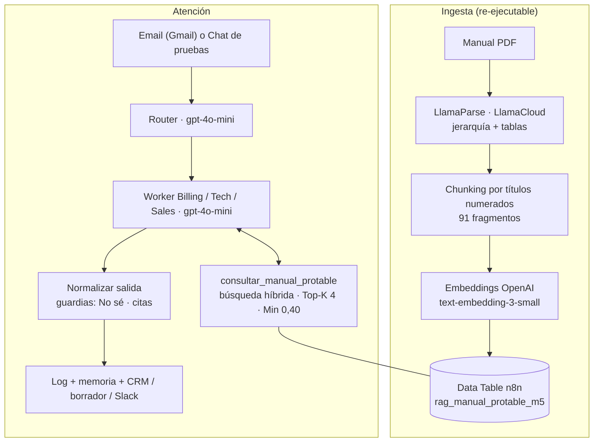

# Entregable 5 — RAG: el agente responde con el manual de soporte

**Pre-entrega del Módulo 5.** Archivo de entrega:
[`PreEntrega_Modulo5_BrunoAcorsi.pdf`](PreEntrega_Modulo5_BrunoAcorsi.pdf) (las 5 piezas en orden).

El sistema multi-agente del Módulo 4 suma una **base de conocimiento real**: el
[Manual de soporte de ProTable v1.0](Manual_Soporte_ProTable_v1.0.pdf) (14 páginas, 15 capítulos,
91 subsecciones, armado solo con fuentes reales del producto). Los tres especialistas consultan el
manual con una herramienta de recuperación, responden **solo con lo que dicen los fragmentos**,
citan la sección y, si el manual no trae la respuesta, dicen literalmente **"No sé"**.

## Archivos

| Archivo | Qué es |
|---|---|
| `PreEntrega_Modulo5_BrunoAcorsi.pdf` | La entrega: parseo, Top-K y Minimum Score, System Prompt, pruebas ciegas y gobernanza |
| `Manual_Soporte_ProTable_v1.0.pdf` · `manual-soporte-protable.md` | El documento maestro (y su fuente en Markdown) |
| `checkpoint5_bruno_acorsi.json` | Manager M5: copia del M4 + workers M5 + Chat Trigger de pruebas |
| `worker1_billing_modulo5_acorsi_bruno.json` | Worker de facturación con RAG |
| `worker2_tech_support_modulo5_acorsi_bruno.json` | Worker técnico con RAG y `registrar_ticket` |
| `worker3_sales_modulo5_acorsi_bruno.json` | Worker comercial con RAG |
| `rag_consultar_manual_modulo5_acorsi_bruno.json` | La herramienta de recuperación (sub-workflow): Top-K 4, Minimum Score 0,40 |
| `M5_ingesta_manual_llamacloud.json` | Ingesta: PDF → LlamaParse (LlamaCloud) → chunking → embeddings → tabla de n8n |

## Arquitectura

**Decisión técnica.** El índice de LlamaCloud que propone la consigna no se puede crear con el plan
gratuito: el Index nuevo exige carpetas (HTTP 403, *"requires a Starter, Pro, or Enterprise plan"*) y
el índice anterior ya no se crea en organizaciones nuevas. LlamaCloud se usa para subir y parsear el
documento maestro (gratis) y la recuperación se implementa en n8n con Top-K y Minimum Score propios.
La interfaz con los agentes es la misma: con el plan Starter, solo cambia el interior del sub-workflow.

## Parámetros de recuperación

| Parámetro | Valor | Por qué |
|---|---|---|
| Top-K | 4 | La sección que responde no siempre sale primera: en las pruebas ciegas, la 3.2 y la 8.2 salieron 3.ª y la respuesta las usa |
| Minimum Score | 0,40 | Calibrado con 27 consultas: el acierto más flojo dio 0,44; el ruido fuera del manual, hasta 0,35 |
| Búsqueda | 0,8 semántica + 0,2 léxica | Con solo vectores, "comisión sobre las ventas" daba 0,34 contra la sección que lo dice casi literal |

El umbral **no alcanza solo**: hay preguntas fuera del manual con vocabulario del dominio que lo
superan. Por eso la regla "No sé" del System Prompt y una guardia en código deciden si los fragmentos
responden exactamente lo preguntado.

## Pruebas de validación (reproducibles)

Corridas de punta a punta por el manager M5 con **Open chat** (Chat Trigger de pruebas), sobre la
versión final, el 11/10/2026. Para repetir la auditoría, escribí el mensaje exacto en el chat.

| # | Ejecución | Mensaje de prueba (exacto) | Resultado esperado | Resultado obtenido |
|---|---|---|---|---|
| 1 | 375 | `¿Mis clientes tienen que instalarse algo en el celu para poder pedir?` | Sinónimo "celu" → secciones 3.2/4.2 | ✅ "No necesitan instalar ninguna aplicación… escanean el QR… (secciones 3.2 y 4.2)" |
| 2 | 378 | `Un cliente pagó con Mercado Pago pero en la tablet el pedido sigue trabado en caja, ¿qué hago?` | "Trabado en caja" → 14.6 | ✅ "Tocá *Refrescar Estado MP* en la tarjeta del pedido… (sección 14.6)" |
| 3 | 381 | `Somos cuatro en la mesa y queremos pagar cada uno lo suyo, ¿se puede?` | "Cada uno lo suyo" → 8.1/8.2 | ✅ "Se puede dividir la cuenta… por ítems, partes iguales o monto personalizado (secciones 8.1 y 8.2)" |
| 4 | 384 | `¿Cuánto me sale el abono más básico y hasta cuántas mesas cubre?` | "Abono" → 2.1 | ✅ "Starter, $25.000 por mes, hasta 15 mesas (sección 2.1)" |
| 5 | 387 | `Tengo el plan Pro con soporte prioritario: ¿en cuántas horas me tienen que responder un reclamo?` | El manual no informa plazos → **No sé** | ✅ "No sé: esa información no está en el manual de soporte de ProTable. Tu caso pasa a una persona del equipo, que lo va a revisar." |

Precisión: **5/5**. El análisis de las fallas encontradas durante la construcción (y sus correcciones,
con número de ejecución) está en la Pieza 4 del PDF.

## Cómo importarlo

1. Importá los 6 JSON en n8n. Credenciales: OpenAI (modelos y embeddings), LlamaParse (ingesta),
   Google Sheets (memoria, log y tickets), y Gmail, HubSpot y Slack si vas a usar la entrada por email.
2. Creá una Data Table `rag_manual_protable_m5` con las columnas `chunk_id`, `seccion`, `capitulo`,
   `titulo`, `contenido`, `tokens_aprox` (número), `embedding`, `version_manual`, y apuntá a ella los
   nodos de la ingesta y de la herramienta.
3. Ejecutá `M5_ingesta_manual_llamacloud` una vez (carga los 91 fragmentos).
4. Publicá la herramienta y los tres workers: n8n no ejecuta sub-workflows sin publicar.
5. Probá desde **Open chat** del manager. El manager queda sin publicar a propósito: comparte la
   casilla de Gmail con el M4.
