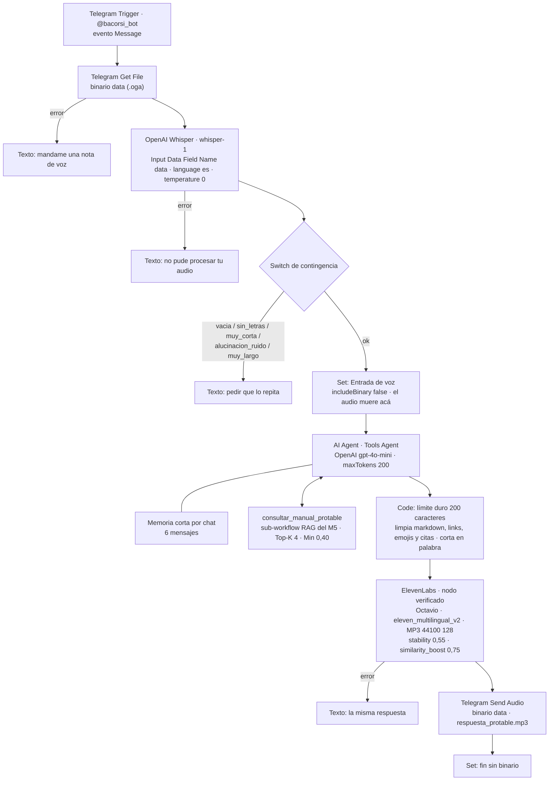

# Entregable 6 — Voz: el agente de soporte responde notas de voz con audio

**Pre-entrega del Módulo 6.** Archivo de entrega:
[`PreEntrega_Modulo6_BrunoAcorsi.pdf`](PreEntrega_Modulo6_BrunoAcorsi.pdf) (los 8 componentes en el orden del flujo,
viabilidad, pautas VUI, decisiones y pruebas).

El soporte de ProTable suma un **canal de voz por Telegram**. El encargado de un local manda una nota de voz y recibe
la respuesta **en audio**, en 200 caracteres como máximo. Whisper transcribe la nota, un AI Agent consulta el
**Manual de soporte de ProTable** con la herramienta RAG del Módulo 5 y ElevenLabs convierte la respuesta en un MP3
que Telegram envía al mismo chat. El audio del cliente se descarta después de transcribirlo y las ejecuciones no se
guardan.

## Archivos

| Archivo | Qué es |
|---|---|
| `PreEntrega_Modulo6_BrunoAcorsi.pdf` | La entrega: componentes 1 a 8 con capturas de la ejecución real 477, ROI y fatiga cognitiva, pautas VUI y privacidad, decisiones y pruebas |
| `checkpoint6_bruno_acorsi.json` | El workflow de voz (n8n, carpeta M6, publicado) |

Dependencia del Módulo 5: el sub-workflow `rag_consultar_manual_modulo5_acorsi_bruno`
(en [`../entregable-5/`](../entregable-5/)), que el agente usa como herramienta `consultar_manual_protable`.

## Arquitectura

**Decisión técnica.** No es un duplicado del manager del M5: es un workflow de voz propio que reutiliza la
herramienta del manual. Los workers del M4/M5 no se conectaron como herramientas por **latencia** (cada worker es otro
agente con su propio modelo y su propia consulta al manual; la ejecución 477 ya tardó 14,3 s con una sola ronda) y
por **simplicidad** (los workers están armados para el mail: borrador, CRM y Slack). El worker de Tech Support se
puede sumar como herramienta más adelante sin tocar el resto del flujo.

## Compliance

| Medida | Dónde |
|---|---|
| `saveDataSuccessExecution: none`, `saveDataErrorExecution: none`, `saveManualExecutions: false`, `saveExecutionProgress: false` | Workflow → Settings (aplicado el 12/10, **después** de capturar la evidencia) |
| El binario se descarta después de transcribir | `Set - Entrada de voz (descarta audio)`, Include Binary File = off |
| No se registra ni el audio ni la transcripción | Sin planillas, Slack ni logs de contenido |

Límites declarados: Telegram conserva el audio original en el chat; OpenAI y ElevenLabs tienen sus propias políticas
de retención (control pendiente: verificarlas). Marco: Ley 25.326 y principio de minimización.

## Pruebas de validación

Ejecuciones reales del 12/10/2026. Las 457 a 475 corrieron en un banco de pruebas sin Telegram
(`M6_prueba_voz_sin_telegram`) con audios generados con la voz Helena de Windows; las 477 y 479, por Telegram con
notas de voz reales.

| # | Ejecución | Entrada (exacta) | Resultado esperado | Resultado obtenido |
|---|---|---|---|---|
| 1 | 457, 459, 461 | Audio: `¡Hola! Un cliente pagó con Mercado Pago y el pedido sigue trabado en caja. ¿Qué tengo que hacer?` + 3 s de silencio | La consulta sale por `ok`; el silencio, por contingencia | ✅ Transcripción exacta. Sobre el silencio Whisper alucinó *"Subtítulos realizados por la comunidad de Amara.org"* y el Switch lo derivó a `alucinacion_ruido`. ⚠️ El agente agregaba "Esto está en la sección 14.6 del manual" |
| 2 | 475 | La misma consulta, con la limpieza de citas en el Code | Respuesta limpia de ≤ 200 caracteres | ✅ 114 caracteres limpios, MP3 de 145 kB |
| 3 | 477 | Nota de voz por Telegram (8 s, `.oga` 169 kB): `Hola, un cliente pagó con Mercado Pago y el pedido sigue en caja. ¿Qué hago?` | Consulta el manual (14.6) y responde en audio | ✅ Consultó el manual. TTS de 108 caracteres: *"Tocá "Refrescar Estado MP" en la tarjeta del pedido. Si el pago está aprobado, el pedido pasará a Pendiente."* MP3 146 kB, Telegram `ok`, audio de 9 s recibido en el celular |
| 4 | 479 | Nota de voz por Telegram (8 s): `Un cliente hizo el pagamento por Mercado Pago, pero el pagamento está pendiente, está pendiente en la caja.` | Consulta el manual y responde en audio | ⚠️ Whisper entendió aunque la consulta mezcló portugués. El agente **no volvió a consultar el manual** (usó la memoria del turno anterior) y agregó "Revisá si el cliente eligió Mercado Pago", que no sale del manual. TTS de 95 caracteres |

**Hallazgo de la prueba 4.** El System Message dice "consultá SIEMPRE la herramienta", pero con memoria el modelo
puede saltearla. Mejora propuesta: forzar la consulta en cada turno (llamar a la herramienta antes del agente) o
validar la respuesta con el Juez del Módulo 8.

Cubiertos por diseño, sin probar de punta a punta todavía: mensaje de texto en vez de audio, audio de más de 90 s,
audio corrupto y falla de ElevenLabs (respuesta en texto).

## Cómo importarlo

1. Instalá el nodo verificado de ElevenLabs (`@elevenlabs/n8n-nodes-elevenlabs`): panel de nodos → buscar
   "ElevenLabs" → Install.
2. Importá `checkpoint6_bruno_acorsi.json` en n8n y asigná las credenciales: Telegram (el token del bot de
   @BotFather), OpenAI (Whisper y el modelo del agente) y ElevenLabs (API key con permiso de Text to Speech).
3. En el nodo de ElevenLabs elegí la voz (acá: *Octavio – Calm Narrator*, por ID) y cargá en *Voice Settings*
   `{ "stability": 0.55, "similarity_boost": 0.75 }`.
4. Importá y publicá el sub-workflow `rag_consultar_manual_modulo5_acorsi_bruno` del Módulo 5 y apuntá la herramienta
   `consultar_manual_protable` a su id: n8n no ejecuta sub-workflows sin publicar.
5. Publicá el workflow. Telegram admite **un solo webhook por bot**: si otro workflow usa el mismo bot, desactivalo
   antes.
6. Mandale una nota de voz al bot. Con los settings de compliance las ejecuciones no quedan en el historial: para
   depurar, activá temporalmente el guardado.
