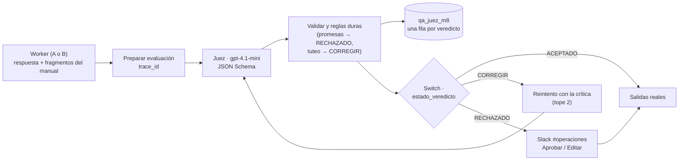

# Entregable 8 — Supervisor AI-as-a-Judge, matriz A/B y dashboard

**Checkpoint del Módulo 8.** Archivo de entrega:
[`Checkpoint_Modulo8_Acorsi_Bruno.pdf`](Checkpoint_Modulo8_Acorsi_Bruno.pdf).

Ninguna respuesta de un especialista llega al cliente (chat, memoria, CRM, borrador de Gmail o Slack)
sin pasar por un **Juez**: un nodo LLM aparte que califica la respuesta contra el contexto recuperado y
devuelve un JSON validado por esquema. **El Juez pone la nota y el código hace cumplir la política.**

## Archivos

| Archivo | Qué es |
|---|---|
| `Checkpoint_Modulo8_Acorsi_Bruno.pdf` | La entrega: supervisor y rúbrica (bloque 1), matriz A/B (bloque 2) y dashboard (bloque 3) |
| `checkpoint8_bruno_acorsi.json` | Manager M8: el agente del M5 con el supervisor enganchado y el banco de pruebas A/B por chat |
| `supervisor_juez_m8_acorsi_bruno.json` | Sub-workflow del Juez: validación, Switch de 3 rutas, reintento con tope y Slack Aprobar / Editar |
| `worker*_modulo8A_acorsi_bruno.json` | Especialistas de la arquitectura A (Groq `openai/gpt-oss-120b`) |
| `worker*_modulo8B_acorsi_bruno.json` | Especialistas de la arquitectura B (OpenAI `gpt-4o-mini`) |

## Arquitectura

## Pruebas (reproducibles por el chat del manager)

El chat acepta un prefijo de banco de pruebas: `#A C1 | consulta` corre la arquitectura A con el caso C1;
`#B DEMO CORREGIR | consulta` fuerza la ruta de corrección. Sin prefijo, el chat usa la arquitectura B.

| Ruta | Ejecución | Mensaje exacto | Resultado |
|---|---|---|---|
| ACEPTADO | 403 | `#B C1 NORMAL \| che, cuánto sale el plan pro y qué trae? me cobran comisión por cada venta?` | 5/5 · ACEPTADO: "$50.000 por mes … no se cobra comisión" |
| CORREGIR → ACEPTADO | 441 | `#B DEMO CORREGIR \| un cliente pagó con mercado pago y el pedido sigue en En Caja, qué hago?` | Intento 0 en tuteo → la regla de tono lo pasa a CORREGIR → intento 1 con voseo → 5/5 · ACEPTADO |
| RECHAZADO → Slack | 452 | `#B DEMO RECHAZAR \| me cobraron dos veces la suscripción de este mes, qué hago?` | Promesa de reembolso → 2/5 · RECHAZADO · PROMESA_NO_AUTORIZADA → Aprobar / Editar en `#operaciones` |

Las 10 corridas del A/B (C1–C5 × A y B, ejecuciones 398–436) están en la matriz del PDF.
**Resultado:** B resolvió 5/5 y A 3/5 (2 fallas técnicas de Groq: `tool call validation failed`).
**Recomendación:** B en producción.

## Cómo importarlo

1. Importá los 8 JSON. Credenciales: OpenAI, Groq (solo arquitectura A), Google Sheets, Slack OAuth2.
2. Creá la Data Table `qa_juez_m8` (las 24 columnas están en `entregable-9/informe-m9.md`, sección de trazabilidad) y apuntá a ella los dos nodos de log del supervisor.
3. Publicá el supervisor y los 6 workers (n8n no ejecuta sub-workflows sin publicar).
4. Probá desde **Open chat** del manager con los mensajes de la tabla.
